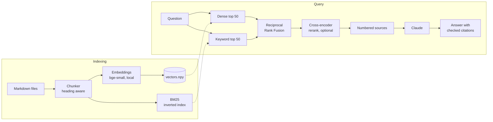

<div align="center">

# RAG from Scratch

**Retrieval augmented generation built from first principles: no LangChain, no LlamaIndex, no vector database.**

[](https://github.com/kshyatisekhar-panda/rag-from-scratch/actions/workflows/tests.yml)


[](LICENSE)

</div>

Every step between a folder of documents and a cited answer is written out by hand in about 750 lines of Python: chunking, keyword search, vector search, rank fusion, reranking, prompting, citation checking and evaluation. Each step is small enough to read in one sitting and is measured, not assumed.

The demo corpus is the [FastAPI documentation](https://github.com/fastapi/fastapi): 123 pages and 459 code examples, indexed as 1,551 chunks.

## Contents

- [Highlights](#highlights)
- [Demo](#demo)
- [How it works](#how-it-works)
- [Results](#results)
- [Quick start](#quick-start)
- [CLI reference](#cli-reference)
- [Design decisions](#design-decisions)
- [Project structure](#project-structure)
- [Roadmap](#roadmap)

## Highlights

- **Hybrid retrieval.** BM25 and dense embeddings are fused with Reciprocal Rank Fusion. In the eval they miss different questions, and together they find the right page in the top 10 for 37 of 38 questions.
- **Structure aware chunking.** Chunks follow markdown headings, keep code blocks whole whenever they fit and carry their heading trail (`Security > OAuth2 with JWT > Hash passwords`) into the embedding.
- **Grounded answers.** Claude answers only from numbered sources. Citations are parsed and checked in code, and any citation that points at nothing is flagged.
- **Measured, not guessed.** A retrieval eval reports hit@k, MRR and latency for every retriever, without spending API credits.
- **Runs on a laptop.** Embeddings and reranking use small local models on CPU. Only the final answer calls an API.
- **Tested.** Unit tests cover every retrieval component and run in CI on Python 3.10 to 3.12 in a few seconds, with no model downloads.

## Demo

The question never mentions CORS, yet hybrid search ranks the CORS page first:

```console
$ rag search "How do I let my React app on localhost:3000 call the API?" -k 3

[1] tutorial/cors.md  ·  CORS (Cross-Origin Resource Sharing) > Steps  (score 0.031)
    So, let's say you have a frontend running in your browser at `http://localhost:8080`, and its
    JavaScript is trying to communicate with a backend running at `http://localhost` ...

[2] advanced/strict-content-type.md  ·  Strict Content-Type Checking > Example Attack  (score 0.029)
[3] tutorial/frontend.md  ·  Frontend  (score 0.028)
```

`rag ask` takes the same retrieved chunks, sends them to Claude as numbered sources and streams back an answer that cites them as `[1]`, `[2]`. It then lists the sources and marks which ones the answer actually used.

## How it works



| Stage | Module | Implementation |
|---|---|---|
| Loading | [`documents.py`](rag/documents.py) | Reads `.md`, `.txt` and `.rst` files in a stable order so builds are reproducible. |
| Chunking | [`chunking.py`](rag/chunking.py) | Splits at headings while tracking code fences, so a `#` comment in code is not read as a heading. Packs paragraphs and code blocks up to 1,200 characters and overlaps on paragraph boundaries. Oversized blocks are split by line, then by sentence. |
| Keyword search | [`bm25.py`](rag/bm25.py) | Okapi BM25 (k1 = 1.5, b = 0.75) on an inverted index. Identifiers such as `response_model` are also indexed as `response` and `model`. |
| Vector search | [`vector_store.py`](rag/vector_store.py) | Vectors are normalised once, so cosine similarity is one matrix product. `argpartition` selects the top k in linear time. |
| Fusion | [`retrieval.py`](rag/retrieval.py) | Reciprocal Rank Fusion, `score = Σ 1 / (60 + rank)`. It uses ranks only, so BM25 scores never have to be calibrated against cosine scores. |
| Reranking | [`models.py`](rag/models.py) | `cross-encoder/ms-marco-MiniLM-L-6-v2` reads each question and passage together and rescores the top 50 candidates. |
| Generation | [`generation.py`](rag/generation.py) | Builds a prompt with numbered sources under a size budget, streams the answer from Claude and validates every `[n]` citation. |
| Evaluation | [`evaluation.py`](rag/evaluation.py) | hit@k, MRR and mean latency per retriever. |

Dependencies are kept to three: **numpy**, **sentence-transformers** (only to run the two local models) and the **Anthropic SDK**.

## Results

Retrieval quality on [`eval/questions.jsonl`](eval/questions.jsonl): 38 developer questions, each labelled with the documentation page that answers it. A retriever scores a hit at k when a chunk from that page is ranked k or better. Measured on a laptop CPU.

| Retriever | hit@1 | hit@3 | hit@5 | hit@10 | MRR | Latency |
|---|:---:|:---:|:---:|:---:|:---:|---:|
| BM25 | 0.55 | 0.71 | 0.82 | 0.89 | 0.659 | 1 ms |
| Dense | 0.66 | **0.87** | 0.89 | 0.92 | 0.769 | 17 ms |
| Hybrid (RRF) | 0.66 | 0.82 | 0.89 | 0.97 | 0.761 | 20 ms |
| Hybrid + rerank | **0.68** | **0.92** | **0.97** | **1.00** | **0.806** | 2.2 s |

**What the numbers show**

1. **Keyword and semantic search fail on different questions.** BM25 misses four, including *"How do I get the currently logged in user inside an endpoint?"*. Dense search misses three, including *"Can I mount an existing Flask app inside FastAPI?"*. Only one question is on both lists, so fusion leaves a single miss in the top 10.
2. **Fusion improves recall more than the top rank.** Hybrid matches dense at hit@1 and hit@5 and wins at hit@10, while dense alone is slightly ahead at hit@3.
3. **Reranking buys precision at a latency cost.** It raises hit@3 from 0.82 to 0.92 and finds every answer page in the top 10, but adds about 2 seconds per query on CPU. That suits a chat assistant and not search as you type, so it is an opt-in flag.

> **Caveat.** 38 questions is a small set and I wrote them myself, so differences of one or two questions are within noise. No parameters were tuned against this set.

Reproduce the table with `rag eval`.

## Quick start

**Requirements:** Python 3.10 or newer, git, and an [Anthropic API key](https://console.anthropic.com/) for answers (search and eval work without one).

```bash
git clone https://github.com/kshyatisekhar-panda/rag-from-scratch.git
cd rag-from-scratch

python -m venv .venv
source .venv/bin/activate        # Windows: .venv\Scripts\activate

# Optional: the CPU build of torch is a much smaller download
pip install torch --index-url https://download.pytorch.org/whl/cpu
pip install -e ".[dev]"
```

Build the index and measure it:

```bash
python scripts/fetch_fastapi_docs.py   # sparse git clone of the docs into data/fastapi
rag ingest data/fastapi                # about 2 minutes on a laptop CPU
rag eval                               # reproduces the results table
```

Ask questions:

```bash
export ANTHROPIC_API_KEY=sk-ant-...    # PowerShell: $env:ANTHROPIC_API_KEY="sk-ant-..."
rag ask "How do I hash passwords and issue JWT tokens?" --rerank
rag chat
```

To use your own documents, run `rag ingest path/to/folder`.

## CLI reference

| Command | Purpose |
|---|---|
| `rag ingest <folder>` | Chunk, embed and index a folder. Options: `--model`, `--chunk-size`, `--overlap`. |
| `rag search "<query>"` | Show the retrieved chunks with scores. No API call. |
| `rag ask "<question>"` | Retrieve, then answer with citations. |
| `rag chat` | Ask questions in a loop. |
| `rag eval` | Compare all retrievers. Options: `--show-misses`, `--out results.md`, `--no-rerank`. |

`search`, `ask` and `chat` accept `--mode dense|bm25|hybrid` (default `hybrid`), `-k` (default 6) and `--rerank`. Every command accepts `--index <folder>` (default `index/`).

| Environment variable | Default | Purpose |
|---|---|---|
| `ANTHROPIC_API_KEY` | none | Required for `ask` and `chat` |
| `RAG_MODEL` | `claude-opus-5-5` | Model used for answers |
| `RAG_EFFORT` | `low` | Reasoning effort: `low`, `medium`, `high` |

## Design decisions

<details>
<summary><b>Why no vector database?</b></summary>

1,551 vectors of 384 floats take 2.4 MB, and exact search over them takes well under a millisecond. Approximate indexes such as HNSW pay off at millions of vectors, not thousands. Exact search is also the baseline any approximate index should be measured against.
</details>

<details>
<summary><b>Why embed the heading trail with each chunk?</b></summary>

A paragraph such as "Import it from fastapi" means nothing on its own. With "CORS > Use CORSMiddleware" in front of it, both the embedding and BM25 know what it is about. It is the cheapest form of contextual chunking: no extra model calls.
</details>

<details>
<summary><b>Why Reciprocal Rank Fusion instead of a weighted score?</b></summary>

BM25 scores are unbounded and depend on the query, while cosine similarity lives in [-1, 1]. Mixing them needs per corpus calibration. RRF uses only ranks, has a single parameter that rarely needs tuning, and is the standard baseline for hybrid search.
</details>

<details>
<summary><b>Why check citations in code?</b></summary>

A model can cite `[7]` when only six sources were given, and a reader cannot tell. The citations are parsed after generation, invalid ones are reported, and the source list marks which sources the answer used. The same check is the starting point for an automated faithfulness eval.
</details>

<details>
<summary><b>Why rebuild BM25 on every load?</b></summary>

It takes milliseconds. Persisting it would add a second file format that must stay in sync with the chunks.
</details>

<details>
<summary><b>Why inline the code examples into the corpus?</b></summary>

The FastAPI docs pull their examples in with include directives at build time. Without resolving them, the corpus would lose the code, which is exactly what developers search for. The fetch script replaces each include with the real file in a fenced block.
</details>

## Project structure

```
rag-from-scratch/
├── rag/
│   ├── documents.py      Document and Chunk types, file loading
│   ├── chunking.py       heading aware markdown chunker
│   ├── bm25.py           Okapi BM25 on an inverted index
│   ├── vector_store.py   exact cosine search in numpy
│   ├── models.py         local embedding and reranking models
│   ├── index.py          build, save and load an index
│   ├── retrieval.py      dense, keyword, hybrid, rerank
│   ├── generation.py     prompt, Claude call, citation checks
│   ├── evaluation.py     hit@k, MRR, latency
│   └── cli.py            the rag command
├── scripts/
│   └── fetch_fastapi_docs.py
├── eval/
│   └── questions.jsonl   38 labelled questions
└── tests/
    └── test_core.py
```

An index on disk is three plain files: `chunks.jsonl`, `vectors.npy` and `manifest.json`, which records the embedding model and chunker settings it was built with.

## Testing

```bash
pytest
```

The tests cover chunking edge cases, BM25 ranking, the vector store, fusion, index persistence, the context budget and citation checks. A small keyword embedder stands in for the neural model, so the suite runs in a few seconds without downloading anything.

## Roadmap

- [ ] Answer quality eval: faithfulness and citation accuracy graded by an LLM judge
- [ ] Query rewriting so follow up questions in `rag chat` keep their context
- [ ] Compare chunk sizes and embedding models in the eval
- [ ] Incremental indexing that only re-embeds changed files

## License

[MIT](LICENSE). The FastAPI documentation used as the demo corpus is also MIT licensed. It is downloaded during setup and not stored in this repository.
