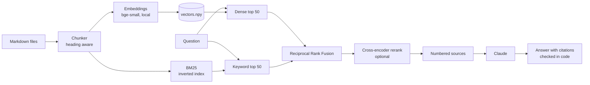

# RAG from scratch

Retrieval augmented generation without LangChain or LlamaIndex. Every step between a folder of documents and a cited answer is written out by hand in about 750 lines of Python, so you can read it and measure it.

The demo corpus is the [FastAPI documentation](https://github.com/fastapi/fastapi) (MIT licensed): 123 pages and 459 code examples, split into 1,551 chunks.

The question below never says "CORS", yet hybrid search ranks the CORS page first:

```
$ rag search "How do I let my React app on localhost:3000 call the API?" -k 3

[1] tutorial/cors.md  ·  CORS (Cross-Origin Resource Sharing) > Steps  (score 0.031)
    So, let's say you have a frontend running in your browser at `http://localhost:8080`, and its
    JavaScript is trying to communicate with a backend running at `http://localhost` ...

[2] advanced/strict-content-type.md  ·  Strict Content-Type Checking > Example Attack  (score 0.029)
[3] tutorial/frontend.md  ·  Frontend  (score 0.028)
```

`rag ask` sends the top chunks to Claude and prints an answer that cites them as [1], [2], followed by the list of sources it used.

## How it works



| Step | File | What is built by hand |
|---|---|---|
| Chunking | [rag/chunking.py](rag/chunking.py) | Splits at markdown headings and keeps the heading trail ("Security > OAuth2 > Hash passwords"). Code fences are never cut in half, and a `#` inside code is not mistaken for a heading. Overlap follows paragraph boundaries. |
| Keyword search | [rag/bm25.py](rag/bm25.py) | Okapi BM25 on an inverted index. snake_case identifiers are also indexed by their parts, so `response_model` matches "response model". |
| Vector search | [rag/vector_store.py](rag/vector_store.py) | Exact cosine search as one numpy matrix product, with `argpartition` for top k. |
| Hybrid fusion | [rag/retrieval.py](rag/retrieval.py) | Reciprocal Rank Fusion, which combines rankings without calibrating BM25 scores against cosine scores. |
| Reranking | [rag/models.py](rag/models.py) | An optional cross-encoder rescores the top 50 candidates by reading the query and passage together. |
| Generation | [rag/generation.py](rag/generation.py) | Sources are numbered in the prompt. Claude must cite them, and every citation is checked against the sources actually given. |
| Evaluation | [rag/evaluation.py](rag/evaluation.py) | hit@k and MRR on 38 hand written questions, with no API cost. |

The only libraries are numpy, sentence-transformers (to run the two small local models) and the Anthropic SDK.

## Results

Retrieval on [eval/questions.jsonl](eval/questions.jsonl). A question counts as a hit when a chunk from the right documentation page is ranked at k or better. Measured on CPU.

| Retriever | hit@1 | hit@3 | hit@5 | hit@10 | MRR | ms/query |
|---|---|---|---|---|---|---|
| BM25 | 0.55 | 0.71 | 0.82 | 0.89 | 0.659 | 1 |
| Dense | 0.66 | 0.87 | 0.89 | 0.92 | 0.769 | 17 |
| Hybrid (RRF) | 0.66 | 0.82 | 0.89 | 0.97 | 0.761 | 20 |
| Hybrid + rerank | 0.68 | 0.92 | 0.97 | 1.00 | 0.806 | 2183 |

What the numbers say:

* **The two retrievers miss different questions.** BM25 misses four, including "How do I get the currently logged in user inside an endpoint?". Dense search misses three, including "Can I mount an existing Flask app inside FastAPI?". Only one question appears on both lists, so fusing them leaves a single miss in the top 10.
* **Fusion helps recall more than the top rank.** Hybrid matches dense at hit@1 and hit@5 and beats it at hit@10. Dense alone is slightly better at hit@3, which is the kind of tradeoff a small eval set makes visible.
* **Reranking buys precision, at a cost.** It lifts hit@3 from 0.82 to 0.92 and finds every page in the top 10, but adds about 2 seconds per query on a CPU. That is a fair trade for a chat tool and a poor one for search as you type, so it is a flag (`--rerank`) and not the default.

Caveat: 38 questions is a small set and I wrote them myself, so treat differences of one or two questions as noise. No settings were tuned against these questions.

## Quick start

Requires Python 3.10 or newer.

```bash
python -m venv .venv
.venv/Scripts/activate          # Windows; use `source .venv/bin/activate` elsewhere
pip install torch --index-url https://download.pytorch.org/whl/cpu   # optional, smaller CPU build
pip install -e ".[dev]"

python scripts/fetch_fastapi_docs.py   # sparse git clone of the docs into data/fastapi
rag ingest data/fastapi                # about 2 minutes on a laptop CPU
rag eval                               # reproduces the table above
```

Search works without any API key:

```bash
rag search "return 404 when an item is missing" --mode hybrid
```

Answers need an [Anthropic API key](https://console.anthropic.com/):

```bash
export ANTHROPIC_API_KEY=...           # PowerShell: $env:ANTHROPIC_API_KEY="..."
rag ask "How do I hash passwords and issue JWT tokens?" --rerank
rag chat
```

Point it at your own docs with `rag ingest path/to/folder`. It reads `.md`, `.txt` and `.rst` files.

## Configuration

| Setting | Default | Where |
|---|---|---|
| Embedding model | `BAAI/bge-small-en-v1.5` (384 dims) | `rag ingest --model` |
| Chunk size / overlap | 1200 / 200 characters | `rag ingest --chunk-size --overlap` |
| Retrieval mode | `hybrid` | `--mode dense\|bm25\|hybrid` |
| Chunks sent to Claude | 6 | `-k` |
| Claude model | `claude-opus-5-5` | `RAG_MODEL` env var |
| Effort | `low` | `RAG_EFFORT` env var |

## Design decisions

**Why no vector database?** 1,551 vectors of 384 floats take 2.4 MB, and exact search over them takes well under a millisecond. Approximate indexes such as HNSW pay off at millions of vectors, not thousands, and an exact search is also the honest baseline to measure them against.

**Why rebuild BM25 at load time?** It takes milliseconds. Storing it would add a second file format that must stay in sync with the chunks.

**Why check citations in code?** A model can cite `[7]` when only six sources were given. The CLI flags any citation that points at nothing, and marks which sources were actually used.

**Why embed the heading trail?** Each chunk is embedded as `section trail + text`. A short paragraph such as "Import it from fastapi" means nothing on its own; with "CORS > Use CORSMiddleware" in front of it, it does.

**Why effort `low`?** Answering from six supplied passages is mostly reading, not multi step reasoning, and lower effort is cheaper and faster. Raise it with `RAG_EFFORT=medium` if answers need more synthesis across sources.

## Project layout

```
rag/
  documents.py     loading files, Document and Chunk types
  chunking.py      heading aware markdown chunker
  bm25.py          Okapi BM25
  vector_store.py  numpy cosine index
  models.py        local embedding and reranking models
  index.py         build, save and load an index
  retrieval.py     dense, keyword, hybrid, rerank
  generation.py    prompt, Claude call, citation checks
  evaluation.py    hit@k, MRR
  cli.py           rag ingest | search | ask | chat | eval
scripts/fetch_fastapi_docs.py
eval/questions.jsonl
tests/test_core.py
```

## Tests

```bash
pytest
```

The tests cover chunking, BM25, the vector store, fusion, index persistence and citation checks. They use a small keyword embedder in place of the neural model, so they run in a few seconds with no downloads.

## Next steps

* Answer quality eval: grade faithfulness and citation accuracy with an LLM judge, next to the retrieval metrics.
* Query rewriting for follow up questions in `rag chat`, which today treats every question on its own.
* Contextual chunk headers written by an LLM, compared against the plain heading trail.

## License

MIT. The FastAPI documentation used as the demo corpus is also MIT licensed. It is downloaded at setup and not stored in this repository.
